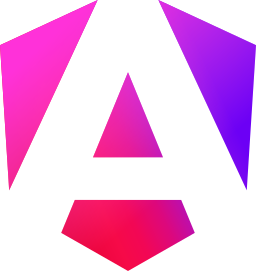
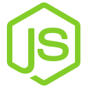
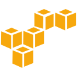
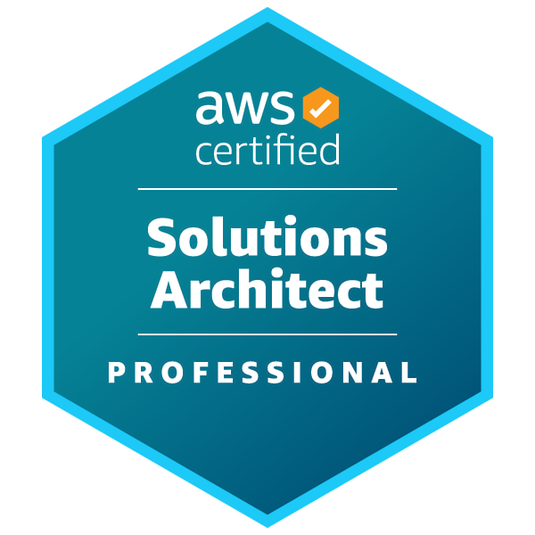
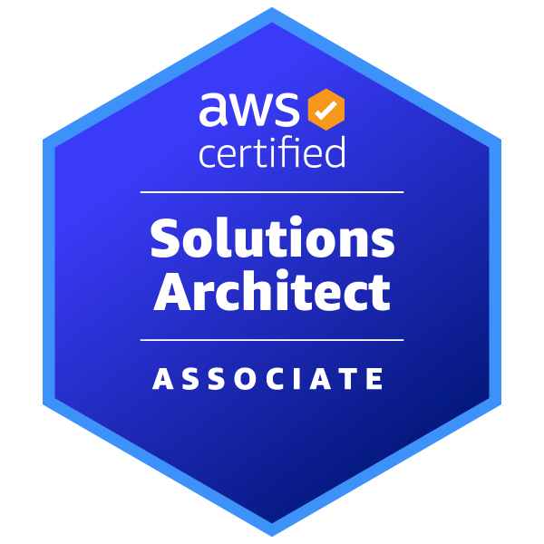
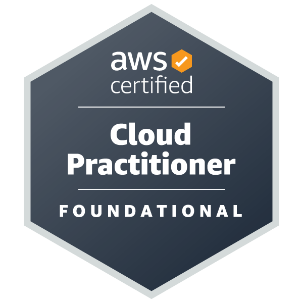
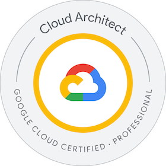
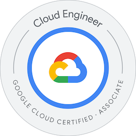

<h1 align="center">Hi there!  I'm Jaime Burgos</h1>

  Senior Fullstack Developer | Angular Contributor | Cloud Architect

  <a href="mailto:jaimeburgostejada@gmail.com">Email</a> |
  <a href="https://www.linkedin.com/in/jaime-burgos-tejada-a45697203/">LinkedIn</a> |
  <a href="https://github.com/advisories?query=credit%3ASkyZeroZx">Angular CVEs</a>

---

### Focus

Angular, NestJS, Nx, APIs, PWA/TWA, cloud architecture, performance, testing, and security research.

### Security research

Credited in [10 GitHub-reviewed Angular advisories](https://github.com/advisories?query=credit%3ASkyZeroZx)

[`CVE-2026-69149`](https://github.com/advisories/GHSA-vpx6-8pjr-4g3v) | [`CVE-2026-50184`](https://github.com/advisories/GHSA-95qp-cmmw-mgqv) | [`CVE-2026-50555`](https://github.com/advisories/GHSA-hqr9-c56f-3x7f) | [`CVE-2026-50556`](https://github.com/advisories/GHSA-gxx4-3xcv-f8qx) | [`CVE-2026-50557`](https://github.com/advisories/GHSA-f3m7-gqxr-g87x) | [`CVE-2026-52725`](https://github.com/advisories/GHSA-692r-grfm-v8x7) | [`CVE-2026-54264`](https://github.com/advisories/GHSA-qxh6-94w6-9r5p) | [`CVE-2026-54265`](https://github.com/advisories/GHSA-58w9-8g37-x9v5) | [`CVE-2026-54267`](https://github.com/advisories/GHSA-rgjc-h3x7-9mwg) | [`CVE-2026-54268`](https://github.com/advisories/GHSA-48r7-hpm6-gfxm)

### Stack

  
  
  
  
  
  
  
  
  
  
  
  
  

### Certifications

  
  
  
  
  
  
  
  

